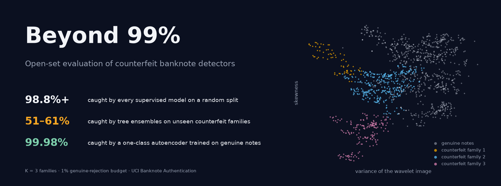
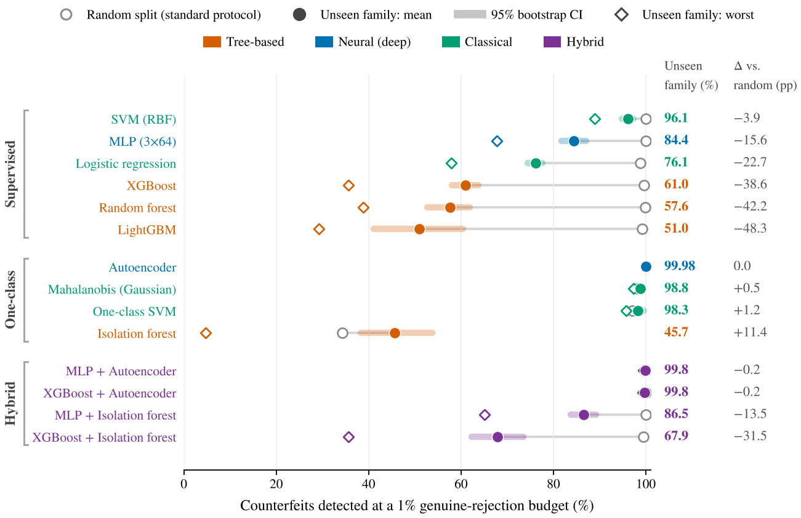
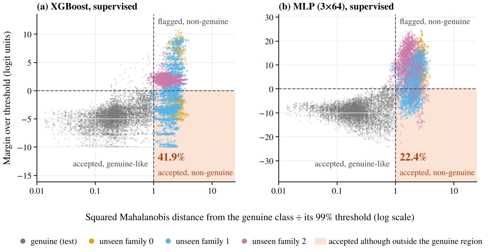

<p align="center"><a href="https://thanatchon36.github.io/beyond99-banknote-detection/paper/"></a></p>

<p align="center">
<a href="https://github.com/thanatchon36/beyond99-banknote-detection/actions/workflows/ci.yml"></a>
<a href="pyproject.toml"></a>
<a href="https://thanatchon36.github.io/beyond99-banknote-detection/paper/"></a>
<a href="paper/paper.pdf"></a>
<a href="https://archive.ics.uci.edu/dataset/267"></a>
<a href="LICENSE"></a>
<a href="https://zenodo.org/badge/latestdoi/1450040425"></a>
<a href="https://huggingface.co/datasets/thanatchon36/beyond99-banknote-detection"></a>
</p>

<p align="center">
📖 <b><a href="https://thanatchon36.github.io/beyond99-banknote-detection/paper/">Read the paper online</a></b> ·
📄 <b><a href="paper/paper.pdf">Download the PDF</a></b> ·
📊 <b><a href="code/results/">Results</a></b> ·
🗂️ <b><a href="https://archive.ics.uci.edu/dataset/267">Data</a></b> ·
🤗 <b><a href="https://huggingface.co/datasets/thanatchon36/beyond99-banknote-detection">Dataset</a></b> ·
📝 <b><a href="CITATION.cff">Citation</a></b>
</p>

**Open-set evaluation of counterfeit banknote detectors.** Machine-learning studies of banknote authentication
routinely report 98–100% accuracy. Those numbers come from random train–test splits in which every counterfeit
production process ("family") appears on both sides of the split. This repository evaluates detectors the way they
fail in practice: on **counterfeit families they have never seen**, at a **fixed 1% genuine-rejection budget**.
Under that protocol, tree ensembles that score above 99% catch only about half of unseen-family counterfeits, while
a one-class autoencoder trained on genuine notes alone catches 99.98%.



## Key findings

- **The standard benchmark is saturated.** Under random splits every supervised model catches at least 98.8% of
  counterfeits, and the best tree ensemble is statistically indistinguishable from an MLP (corrected resampled
  t-test, p = 0.24).
- **Unseen families break supervised detectors.** XGBoost, random forest and LightGBM detect 51–61% of unseen-family
  counterfeits on average and only 29–39% of the hardest family.
- **One-class screening closes the gap.** An autoencoder trained on genuine notes only detects 99.98% (95% CI
  99.94–100) at about 1.7% genuine rejection.
- **The failure is extrapolation, not overlap.** Of the counterfeits XGBoost accepted, 98.9% lie outside the region
  holding 99% of genuine notes.
- **The result is robust.** It holds for every family granularity from K = 2 to 6 and at every genuine-rejection
  budget tested (0.2–20%).

## Install and quickstart

```bash
git clone https://github.com/thanatchon36/beyond99-banknote-detection.git
cd beyond99-banknote-detection
make setup      # uv venv + dependencies (Python 3.12)
make all        # data -> experiments -> lofo -> quadrant -> figures -> paper   (about 10–15 minutes, one CPU core)
make test       # 24 tests, including the README numbers against the paper's Table 5
make models     # train and save all 18 detectors (seconds)
```

Without `uv` or `make`: `pip install -r requirements.txt` and `./reproduce.sh` run the same steps.

| Target | Purpose |
|---|---|
| `data` | Download UCI Banknote Authentication (UCI, then a GitHub mirror) and validate 762 genuine and 610 counterfeit notes |
| `experiments` | E1–E5: benchmark, scarce data, weak features, noise, unseen families → `code/results/` |
| `lofo` | E6: leave-one-family-out for K = 2..6 and 7 budgets → `code/results/e5x_K*.csv` |
| `quadrant` | Mechanism analysis with exact logits → `code/results/quadrant.csv` |
| `figures` | Every figure and LaTeX table, with text-collision checks → `paper/figures/`, `paper/tables/` |
| `models` | Train, calibrate and save all 18 detectors → `code/models/` |
| `paper` | Build `paper/paper.pdf` (tectonic) and the web reader `docs/paper/` |
| `web` | Web reader only → `docs/paper/index.html`, served at <https://thanatchon36.github.io/beyond99-banknote-detection/paper/> |
| `banner` | README banner → `docs/assets/banner.png` |
| `arxiv` | arXiv source bundle → `paper/arxiv.tar.gz` |
| `hf` | Hugging Face dataset bundle → `hf/` (data, family assignments, every result file, card, checksums) |

## Results at a glance

Counterfeits detected (%) at a 1% genuine-rejection budget, K = 3 counterfeit families, 10 seeds.

| Detector | Paradigm | Random split | Unseen family, mean | Unseen family, worst |
|---|---|---:|---:|---:|
| SVM (RBF) | Supervised, classical | 100.0 | 96.1 | 88.9 |
| MLP (3×64) | Supervised, neural | 100.0 | 84.4 | 67.8 |
| XGBoost | Supervised, tree | 99.6 | 61.0 | 35.7 |
| Random forest | Supervised, tree | 99.8 | 57.6 | 38.8 |
| LightGBM | Supervised, tree | 99.2 | 51.0 | 29.3 |
| Autoencoder | One-class, neural | 100.0 | 99.98 | 99.9 |
| Mahalanobis | One-class, classical | 98.3 | 98.8 | 97.3 |
| Isolation forest | One-class, tree | 34.3 | 45.7 | 4.7 |
| XGBoost + Autoencoder | Hybrid | 100.0 | 99.8 | 99.3 |

All 18 detectors, with confidence intervals, are in Table 5 of the paper and in `code/results/`.
`tests/test_results.py` recomputes this table from the result files.

## What the pipeline does

1. **Data** (`banknote_experiments.load_data`): the UCI file is downloaded on first run and validated against the
   expected 762 genuine and 610 counterfeit notes. Label convention: 0 = genuine, 1 = counterfeit.
2. **Detectors**: ten supervised classifiers (logistic regression, k-NN, SVM, decision tree, random forest, extra
   trees, HistGradientBoosting, XGBoost, LightGBM, MLP), four one-class detectors (autoencoder, Mahalanobis,
   one-class SVM, isolation forest) and a 2×2 grid of hybrids.
3. **Random-split benchmark** (E1–E4): repeated stratified 10-fold cross-validation, learning curves, a weaker
   sensor and Gaussian noise on test features.
4. **Open-set evaluation** (E5, E6): counterfeit families are K-means clusters; each family in turn is withheld from
   training, every threshold is calibrated on held-out genuine notes at the budget, and mean and worst-family
   detection are reported with bootstrap intervals over 10 seeds, for K = 2..6 and seven budgets.
5. **Mechanism** (`paper_analysis.py quadrant`): exact margins of the supervised detectors against the Mahalanobis
   distance from the genuine class, separating extrapolation from class overlap.
6. **Deliverables**: every figure and table of the paper (`make_figures.py` checks each figure for overlapping text
   and annotations on data before saving it), the PDF, the web reader and 18 ready-to-use detectors.

## Train and use the detectors

`train_all.py` trains all 18 detectors (10 supervised, 4 one-class, 4 hybrids) on the full data, calibrates each
threshold on held-out genuine notes, and saves ready-to-use bundles.

```bash
cd code
python train_all.py train                   # -> models/*.joblib and models/manifest.json (seconds)
python train_all.py list
python train_all.py predict --model autoencoder --input notes.csv --out scores.csv
python train_all.py predict --model hybrid_xgboost_autoencoder --input notes.csv
```

The input CSV needs the four features `variance, skewness, kurtosis, entropy`, with or without a header row; extra
columns are ignored. From Python:

```python
import train_all
det = train_all.load("autoencoder")
train_all.predict(det, [[3.6216, 8.6661, -2.8073, -0.4470],    # a genuine note from the data
                        [-1.3971, 3.3191, -1.3927, -1.9948]])  # a counterfeit from the data
# array([0, 1])   0 = accepted as genuine, 1 = flagged as counterfeit
```

Notes on the saved detectors:

- Genuine notes are split 80/20 into training and calibration parts. Supervised detectors train on the genuine
  training part plus all counterfeits; one-class detectors on genuine notes only.
- Each threshold is the 99th percentile of calibration scores (`--alpha 0.01`). Hybrids flag a note if either
  component exceeds its own α/2 threshold.
- k-NN and the single decision tree produce coarse scores, so their realised rejection rate cannot match α exactly.
- These bundles are for demonstration and downstream use. Detector evaluation is in `banknote_experiments.py` and
  `paper_analysis.py`.

## Research: *Beyond 99%: Open-Set Evaluation Reveals Silent Failures of Counterfeit Banknote Detectors, and the Case for One-Class Screening*

The preprint by Thanatchon Chongmankhong is in [`paper/`](paper/): a PDF in [`paper/paper.pdf`](paper/paper.pdf),
its LaTeX source [`paper/paper.tex`](paper/paper.tex) in arXiv layout, and a
[web reader](https://thanatchon36.github.io/beyond99-banknote-detection/paper/) built from the same source by
`make web`. `make arxiv` packs the source with its figures and tables into `paper/arxiv.tar.gz`. The paper asks
whether the near-perfect accuracies reported on banknote authentication survive counterfeits from production
processes the detector has never seen, and what a central bank should screen with if they do not. Every table and
figure is generated from `code/results/`; `tests/test_figures.py` checks that the tables regenerate byte for byte.

- Tables: [`paper/tables/`](paper/tables/) · Figures: [`paper/figures/`](paper/figures/)
- Dataset on Hugging Face: [`thanatchon36/beyond99-banknote-detection`](https://huggingface.co/datasets/thanatchon36/beyond99-banknote-detection), with the UCI data, the
  counterfeit family assignments for K = 2..6 and every result file
- Economic analysis (Section 6): the cost of counterfeiting in a low-incidence economy such as Thailand, and who
  bears it.
- Research agenda (Section 8): a pre-specified follow-up study on multispectral Thai banknote data.

<p align="center"></p>

## Repository layout

```
code/
  banknote_experiments.py   data, 14 detectors, experiments E1–E5
  paper_analysis.py         E6: leave-one-family-out for K = 2..6; mechanism analysis
  make_figures.py           every figure and LaTeX table, with text-collision checks
  train_all.py              train, save and use all 18 detectors
  results/                  outputs of the runs reported in the paper (CSV)
paper/
  paper.tex, references.bib, paper.bbl, arxiv.sty
  paper.pdf                 compiled preprint
  reader.html               pandoc template of the web reader
  figures/                  vector PDFs and PNG previews
  tables/                   generated LaTeX tables
docs/
  paper/                    web reader (GitHub Pages)
  assets/banner.png         README banner
scripts/
  paper_web.py              paper.tex -> docs/paper/index.html
  make_banner.py            README banner from the data
  hf_dataset.py             Hugging Face dataset bundle (card: hf_README.md)
tests/                      data, detectors, README numbers, figures and tables
Makefile, pyproject.toml    one target per step; dependencies
reproduce.sh                the same steps without make
```

## Reproducibility

- Every random choice is seeded. In the tested environment, rerunning an experiment reproduces every reported metric
  in `code/results/` exactly; only the timing columns of E1 differ between machines.
- Tested with Python 3.12.3, NumPy 2.5.4, pandas 3.0.6, SciPy 1.18.1, scikit-learn 1.9.1, XGBoost 3.4.1,
  LightGBM 4.7.0, Matplotlib 3.11.2 and joblib 1.6.0. Other versions may change results slightly.
- `make_figures.py` checks each figure before saving it: no two text elements may overlap, and no annotation may
  cover data points.

## Data

UCI Banknote Authentication (Lohweg, 2013; [doi:10.24432/C55P57](https://doi.org/10.24432/C55P57)): 1,372 specimens
described by four statistics of a wavelet-transformed image, released under CC BY 4.0. `make data` downloads it; a copy
with a header, the counterfeit family assignments and every result file is on
[Hugging Face](https://huggingface.co/datasets/thanatchon36/beyond99-banknote-detection). Please cite the original source. Label convention: 0 = genuine, 1 = counterfeit.

## Limitations

The UCI specimens come from one imaging set-up and four features, without infrared, ultraviolet or magnetic
information. Counterfeit "families" are K-means clusters, a statistical proxy for real production processes; the
analysis is repeated for K = 2–6 to reduce this concern. "Deep" models here are small multilayer networks;
convolutional or transformer models on multispectral images are part of the proposed follow-up study.

## Citation

See [`CITATION.cff`](CITATION.cff); each release is archived on Zenodo ([doi:10.5281/zenodo.24049790](https://doi.org/10.5281/zenodo.24049790)). Or:

```bibtex
@misc{chongmankhong2026beyond,
  title  = {Beyond 99\%: Open-Set Evaluation Reveals Silent Failures of Counterfeit
            Banknote Detectors, and the Case for One-Class Screening},
  author = {Chongmankhong, Thanatchon},
  year   = {2026},
  note   = {Preprint},
  doi    = {10.5281/zenodo.24049790},
  url    = {https://thanatchon36.github.io/beyond99-banknote-detection/paper/}
}
```

License: code under the [MIT License](LICENSE). The paper text and figures in `paper/` are © 2026 Thanatchon
Chongmankhong.

## สรุปภาษาไทย

งานวิจัยนี้ทดสอบโมเดล AI ตรวจจับธนบัตรปลอมกับ “ของปลอมตระกูลใหม่” ที่โมเดลไม่เคยเห็นตอนเทรน แทนการสุ่มแบ่งข้อมูลแบบที่งานส่วนใหญ่ใช้ ผลคือโมเดลต้นไม้ (XGBoost, Random Forest, LightGBM) ที่ได้คะแนนเกิน 99% ในการทดสอบปกติ จับของปลอมตระกูลใหม่ได้เพียง 51–61% ขณะที่ autoencoder ซึ่งเรียนจากธนบัตรจริงอย่างเดียวจับได้ 99.98% ทุกตัวเลข ตาราง และรูปในบทความรันซ้ำได้ด้วย `make all` (หรือ `./reproduce.sh`) และอ่านบทความออนไลน์ได้ที่ <https://thanatchon36.github.io/beyond99-banknote-detection/paper/>
